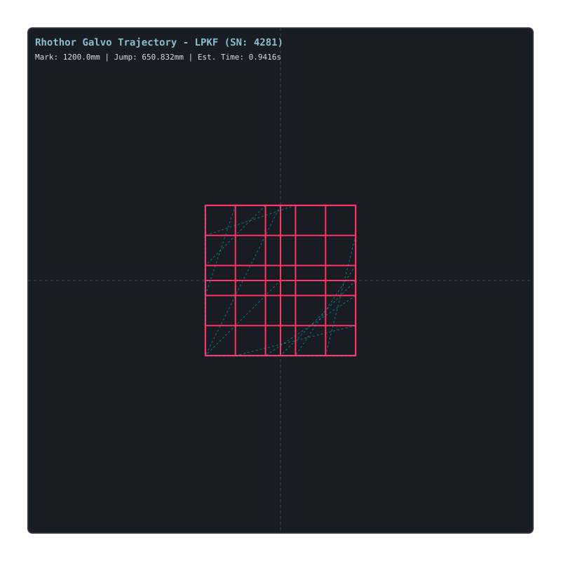

# Rhothor™ Laser Galvo Deflection Controller & SDK

[](https://github.com/chaunt1/laser-controller/releases/latest)
[-00c853?logo=windows)](https://github.com/chaunt1/laser-controller/releases/download/v1.0.0/RhothorStudio-v1.0.0-windows-x64.zip)
[](mailto:chaunt.dev@gmail.com)

Dự án phần mềm điều khiển, chẩn đoán và phát triển ứng dụng cho hệ thống quét chùm tia laser **Newson Rhothor™ 2D & 3D** (tương thích máy **LPKF Laser & Electronics**).

> [!TIP]
> **TẢI VỀ ỨNG DỤNG BẢN WINDOWS (.EXE) SẴN DÙNG**:
> * 🪟 **[Tải RhothorStudio-v1.0.0-windows-x64.zip](https://github.com/chaunt1/laser-controller/releases/download/v1.0.0/RhothorStudio-v1.0.0-windows-x64.zip)** - Chạy trực tiếp trên Windows 10/11 64-bit không cần cài đặt Python.
> * **Tác giả / Nhà phát hành (Publisher):** `chaunt <chaunt.dev@gmail.com>`



---

## 1. Tổng Quan Hệ Thống

Hệ thống **Rhothor™** của hãng **Newson Engineering NV** (Bỉ) là giải pháp điều khiển đầu quét chùm tia laser (Galvanometer Deflection System) độ chính xác cao được sử dụng trong các dòng máy gia công vi mạch, cắt laser PCB của **LPKF**.

### Điểm đặc trưng:
* **Công nghệ động cơ RTSN Lorentz Force:** Triệt tiêu hoàn toàn tổn hao từ trễ và dòng điện xoáy so với công nghệ moving-magnet thông thường, cho tốc độ gia tốc cực lớn và độ trôi nhiệt cực thấp.
* **Bộ điều khiển tích hợp (Integrated Control):** Sử dụng chip DSP chuyên dụng 160 MIPS kết hợp mạch khuếch đại Class-D ngay trên bo mạch RT-CU. Tự xử lý bộ đệm lệnh vector, bù phi tuyến, điều chế công suất laser và đóng mở xung gate mà không cần bo mạch điều khiển phụ trợ (như RTC4/RTC5).
* **Trục Z linh hoạt (ELEVAthor EL-S2):** Thấu kính dịch chuyển tiêu cự động cho phép gia công 3D trên các bề mặt bậc thang, dốc nghiêng hoặc bù cong trường quét mà không cần bàn nâng cơ khí.
* **Kết nối máy tính qua USB:** Giao tiếp qua cổng USB-B cách ly quang 2.5 kV sử dụng driver WinUSB tiêu chuẩn của Microsoft.

---

## 2. Cấu Hình Phần Cứng Hệ Thống LPKF Thực Tế

Dựa trên cấu hình ghi nhận từ phần mềm chẩn đoán của hệ thống:

| Thành Phần | Cấu Hình Kỹ Thuật | Chi Tiết |
| :--- | :--- | :--- |
| **Serial Number** | `4281` | Mã định danh phần cứng bo mạch |
| **Hồ sơ máy** | `LPKF` | LPKF Laser & Electronics AG |
| **Động cơ quét XY** | `RTSN - AR180` | Góc quét 180 mrad (~10.3°), khẩu độ 10mm |
| **Độ trễ bám đuôi** | `60 µsec` | Scanner delay tối ưu hóa góc cắt |
| **Kích thước vùng quét** | `201.65 mm` | Chiều dài cạnh vùng quét vuông |
| **Tốc độ tối đa XY** | `6000 mm/sec` | Tốc độ nhảy nhanh giữa các nét vẽ |
| **Chế độ bám đuôi** | `Normal` | Cân bằng độ chính xác và tốc độ |
| **Trục Z (Dynamic Focus)**| `EL - S2` (ON) | Vùng quét Z: 147 mm, Tốc độ Z: 4000 mm/s |

---

## 3. Cấu Trúc Thư Mục Dự Án

```
rhothor_laser_controller/
├── config/
│   ├── lpkf_ar180_els2.json        # File cấu hình chuẩn đúng theo hệ máy LPKF #4281
│   └── default_2d.json             # Cấu hình tiêu chuẩn cho đầu quét 2D thông dụng
├── docs/
│   ├── WINDOWS_10_11_SETUP.md      # Hướng dẫn cài đặt driver v7.5 trên Windows 10 & 11 không lỗi chữ ký số
│   ├── EZCAD_INTEGRATION_GUIDE.md  # Hướng dẫn kết nối và chạy EzCad (sơ đồ hàn cáp XY2-100 & giải pháp)
│   ├── NEWSON_SUPPORT_PORTAL.md    # Phân tích cổng hỗ trợ chính hãng, gói v11 và Flight SDK
│   ├── LPKF_INTEGRATION.md         # Phân tích kỹ thuật chi tiết cấu hình máy LPKF
│   ├── HARDWARE_WIRING_PINOUT.md   # Sơ đồ chân nguồn X5, USB X6, DB-25 X7, RS485 & Laser
│   ├── API_REFERENCE.md            # Tra cứu chi tiết 50+ hàm API trong rhothor.dll
│   ├── DRIVER_SETUP_GUIDE.md       # Hướng dẫn cài đặt WinUSB trên Windows 7/10/11
│   └── vendor/                     # Toàn bộ Datasheets và Sách hướng dẫn gốc từ hãng Newson
├── vendor/
│   ├── driver/                     # Driver v7.5 & file rhothor_win10_11_x64.inf sạch
│   ├── official_v11/               # Bộ phần mềm v11.0.48.12 v3 mới nhất từ support.newson.be
│   └── flight_sdk/                 # Mã nguồn C# đầy đủ của bộ ứng dụng khắc laser Flight SDK
├── sdk/
│   ├── include/
│   │   ├── rhothorDll.h            # Header C gốc từ hãng Newson
│   │   └── rhothor.hpp             # Wrapper C++17 RAII hiện đại
│   ├── lib/
│   │   ├── x64/                    # DLL và LIB 64-bit cho Windows
│   │   │   ├── rhothor.dll
│   │   │   └── rhothor.lib
│   │   └── x86/                    # DLL và LIB 32-bit cho Windows (kèm Sky Writing dll)
│   ├── python/
│   │   ├── rhothor.py              # Thư viện Python ctypes + tích hợp bộ mô phỏng
│   │   └── simulator.py            # Động cơ mô phỏng động học Galvo & xuất file SVG
│   └── csharp/
│       ├── RhothorNative.cs        # P/Invoke C# (.NET)
│       └── RhothorController.cs    # Lớp điều khiển hướng đối tượng C# an toàn
├── tools/
│   ├── rhothor_cli.py              # Công cụ dòng lệnh test, vẽ mẫu và chẩn đoán
│   ├── ezd_dxf_to_rhothor.py       # Công cụ đọc file vector DXF từ EzCad và bắn laser trực tiếp
│   ├── register_device_guid.reg    # Đăng ký GUID cho Windows 10/11 khi dùng Zadig
│   ├── register_device_guid.ps1    # Script PowerShell tự động cấu hình USB GUID
│   └── web_dashboard/              # Bảng điều khiển trực quan chạy trên trình duyệt
├── examples/
│   ├── 01_connect_and_query.py     # Kết nối và đọc tham số phần cứng
│   ├── 02_marking_2d_shapes.py     # Vẽ các hình 2D: Vuông, tròn, cross, đường đan hatch
│   ├── 03_marking_3d_dynamic.py    # Khắc laser 3D đa tầng tiêu cự với ELEVAthor Z
│   ├── 04_laser_timing_tuning.py   # Tinh chỉnh độ trễ GateOnDelay, GateOffDelay
│   └── 05_io_laser_triggering.py   # Kích xung laser ngoài qua IO7 và phần cứng Oscillator
└── tests/
    └── test_rhothor_sdk.py         # Bộ kiểm thử tự động Unit Tests cho SDK
```

---

## 4. Ứng Dụng Hoàn Chỉnh: Rhothor Laser Studio (Desktop App & Windows .EXE)

Tập hợp toàn bộ tính năng trong bộ thư mục `examples/` thành một ứng dụng máy tính đồ họa chuyên nghiệp (PyQt5):

* **Desktop GUI App**: Khởi chạy trực tiếp bằng lệnh `python rhothor_studio.py` hoặc nhấp đúp `run_studio.bat`.
* **Đóng gói Windows .EXE Độc Lập**: Biên dịch thành 1 file duy nhất `RhothorStudio.exe` thông qua script `tools/windows_setup/build_windows_app.bat` (chạy trên Windows 7, 10, 11 không cần cài Python).
* **5 Tab Chức Năng Tích Hợp**:
  1. **📐 2D Khắc Nét (Ex 02)**: Sinh hình vuông, tròn đồng tâm, crosshair, đan lưới hatch và đọc file CAD `.dxf` / `.plt`.
  2. **🏔️ Tiêu Cự Động 3D (Ex 03)**: Điều khiển trục Z ELEVAthor EL-S2, khắc bậc thang đa tầng và dốc nghiêng 3D.
  3. **⏱️ Hiệu Chuẩn Trễ (Ex 04)**: Tinh chỉnh Gate On/Off delay và tự tạo ma trận vạch test để soi kính hiển vi.
  4. **⚡ Q-Switch & Digital I/O (Ex 05)**: Cấu hình tần số Oscillator phát xung MOPA/Q-switch, bắn xung tĩnh (burst drilling), và bảng điều khiển I/O 8-bit (khí nén, hút khói, đèn laser đỏ, interlock).
  5. **🔌 Kết Nối & Đọc Tham Số (Ex 01)**: Tự động kết nối phần cứng USB hoặc bộ mô phỏng, đọc thanh ghi DSP.
* **Tài liệu chi tiết**:
  - [Sổ Tay Vận Hành Studio](docs/RHOTHOR_STUDIO_USER_GUIDE.md)
  - [Hướng Dẫn Build Windows .EXE](docs/WINDOWS_APP_BUILD_GUIDE.md)

---

## 5. Ứng Dụng Tối Giản Thay Thế EzCad: Rhothor EasyLaser (Web App)

Giải pháp web tối giản không phụ thuộc thư viện ngoài (zero-dependency) dành cho thợ vận hành chỉ cần kéo thả file DXF/PLT:
* Khởi chạy nhanh trên Windows: `tools\windows_setup\start_easylaser.bat`
* Khởi chạy trên Linux: `./apps/easylaser/start_easylaser.sh`
* Giao diện trình duyệt tối ưu tại `http://localhost:8080`: Kéo thả file, căn giữa, quét khung định vị phôi (Laser OFF) và bấm Khắc Laser.

---

## 6. Hướng Dẫn Sử Dụng SDK Python

SDK Python tự động nhận diện môi trường:
* Khi chạy trên Windows có cắm phần cứng: Nạp trực tiếp `rhothor.dll` qua cổng USB.
* Khi chạy trên Linux / macOS hoặc không có phần cứng: Tự động kích hoạt **RhothorSimulator** với độ chính xác cao về động học và độ trễ, cho phép phát triển phần mềm và xuất quỹ đạo đường đi ra file SVG trước khi nạp vào máy thật.

### Mã nguồn mẫu cơ bản:
```python
from sdk.python.rhothor import RhothorController

# Khởi tạo phiên làm việc với máy LPKF
with RhothorController(serial_nr=4281, name="LPKF") as galvo:
    # 1. Cấu hình tốc độ và thời gian trễ laser
    galvo.set_speed(mark_speed=2000.0, jump_speed=6000.0)
    galvo.set_laser_delays(gate_on_delay_us=50, gate_off_delay_us=50)

    # 2. Mở danh sách lệnh (Chế độ đệm kép LIST_START)
    galvo.list_open(1)

    # 3. Thêm các lệnh vẽ vector
    galvo.mark_rectangle(cx=0, cy=0, w=50, h=50)  # Cắt khung chữ nhật 50x50 mm
    galvo.mark_circle(cx=0, cy=0, r=20)           # Cắt hình tròn bán kính 20 mm
    galvo.mark_crosshair(cx=0, cy=0, size=10)     # Dấu tâm căn chỉnh

    # 4. Đóng danh sách để kích hoạt động cơ thực thi
    galvo.list_close()

    # 5. Xem thống kê động học (khi mô phỏng)
    if galvo.simulate:
        stats = galvo.get_simulation_stats()
        print(f"Tổng quãng đường cắt laser: {stats['total_mark_distance_mm']} mm")
        print(f"Thời gian dự kiến: {stats['estimated_time_seconds']} giây")
        galvo.export_simulation_svg("trajectory.svg")
```

---

## 5. Sử Dụng Công Cụ CLI Chẩn Đoán & Kiểm Thử

Công cụ dòng lệnh `rhothor_cli.py` cho phép test nhanh các tính năng mà không cần viết mã:

```bash
# Xem thông tin cấu hình phần cứng
python3 tools/rhothor_cli.py --config config/lpkf_ar180_els2.json --info

# Chạy kiểm thử vẽ hình vuông kích thước 60mm ở tốc độ 1500 mm/s
python3 tools/rhothor_cli.py --config config/lpkf_ar180_els2.json --test square --size 60 --speed 1500

# Chạy toàn bộ bài test hình học và xuất quỹ đạo ra file SVG
python3 tools/rhothor_cli.py --config config/lpkf_ar180_els2.json --test all --size 60 --export-svg demo.svg
```

---

## 6. Chạy Bảng Điều Khiển Trực Quan (Web Dashboard)

Bảng điều khiển trực quan nằm tại `tools/web_dashboard/index.html`. Bạn có thể mở trực tiếp bằng bất kỳ trình duyệt web nào (Chrome, Firefox, Edge, Safari) hoặc phục vụ qua HTTP server nhẹ:

```bash
# Chạy máy chủ tĩnh
python3 -m http.server 8080 --directory tools/web_dashboard/
```
Sau đó truy cập: `http://localhost:8080` để tương tác trực quan với đầu quét và xem đường chạy tia laser thời gian thực.
